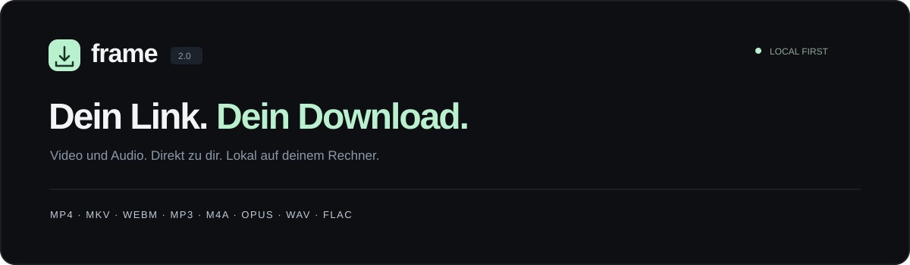

<p align="center"></p>

<p align="center"><strong>Ein lokaler YouTube-Downloader mit einer klaren Dark-Oberfläche.</strong><br>Video in Originalqualität. Audio in deinem Wunschformat. Alles auf deinem Rechner.</p>
<p align="center">Python 3.11+ · macOS / Windows / Linux · MIT · Version 2.0.0</p>

**[Schnellstart](#schnellstart)** · **[Formate](#formate)** · **[Probleme lösen](#probleme-lösen)** · **[Auf GitHub veröffentlichen](docs/GITHUB.md)** · **[Mitentwickeln](CONTRIBUTING.md)**

## Das kann Frame

- YouTube-Videos, Shorts und abgeschlossene Livestreams laden.
- Tatsächlich verfügbare Auflösungen wählen, bis 4K und höher, wenn die Quelle sie anbietet.
- **Video:** MP4, MKV und WebM mit Bild und Ton.
- **Audio:** MP3, M4A, Opus, WAV und FLAC. MP3 mit 96–320 kbit/s.
- Zwei Downloads gleichzeitig, Warteschlange, Fortschritt, Abbrechen und erneuter Versuch.
- Gespeicherter Verlauf und fertige Dateien ohne Konto, Werbung oder Telemetrie.

## Schnellstart

### 1. Einmalig installieren

Du benötigst **[Python 3.11 oder neuer](https://www.python.org/downloads/)** und **[Node.js 22 oder neuer](https://nodejs.org/)**. Deno 2.3+ funktioniert alternativ zu Node.js. Unter Windows bei der Python-Installation den Python Launcher beziehungsweise „Add Python to PATH“ auswählen. Nach einer Installation das Startfenster neu öffnen.

FFmpeg und die Download-Bibliothek yt-dlp richtet Frame beim ersten Start automatisch in `.runtime` ein. Dafür ist eine Internetverbindung nötig. Es werden keine globalen Python-Pakete verändert.

### 2. Projekt herunterladen und starten

Auf GitHub unter **Releases** das Frame-ZIP herunterladen und entpacken. Falls noch kein Release vorhanden ist: **Code → Download ZIP**.

| System | Start |
| --- | --- |
| **macOS** | `Start.command` doppelt anklicken |
| **Windows** | `Start.bat` doppelt anklicken |
| **Linux** | Im Frame-Ordner `sh Start.sh` ausführen |
| **Alternativ** | Im Frame-Ordner `python3 start.py` oder unter Windows `py -3 start.py` ausführen |

Der Browser öffnet **http://127.0.0.1:8765**. Das Startfenster während der Nutzung geöffnet lassen; mit **Ctrl+C** beenden. Wenn Frame schon läuft, öffnet ein erneuter Start die vorhandene Seite.

macOS kann für heruntergeladene Skripte eine Freigabe verlangen. Als Alternative im Terminal den Frame-Ordner öffnen und `python3 start.py` mit Python 3.11+ verwenden. Falls die `.command`-Datei wegen fehlender Ausführungsrechte nicht startet: `chmod +x Start.command Aktualisieren.command` im Projektordner ausführen.

### 3. Deinen Download auswählen

1. YouTube-Link einfügen und **Link prüfen** anklicken.
2. **Video** oder **Nur Audio** wählen.
3. Format und Auflösung beziehungsweise MP3-Bitrate auswählen.
4. **Herunterladen** anklicken. Nach Abschluss bei Bedarf **Datei speichern** verwenden.

Die fertige Datei liegt bereits unter `downloads/<Auftrags-ID>/`. **Datei speichern** erstellt über den Browser eine zusätzliche Kopie an einem Ort deiner Wahl. Das × entfernt einen Verlaufseintrag und behält die Datei auf der Festplatte.

## Formate

| Format | Gut geeignet für | Qualität und Hinweise |
| --- | --- | --- |
| **MP4** | Videos für viele Player | Beste passende Bild- und Tonspuren, ohne erneute Videokodierung. Moderne Codecs benötigen einen geeigneten Player. |
| **MKV** | Flexible Videodateien | Übernimmt moderne Video- und Audiocodecs ohne erneute Videokodierung. |
| **WebM** | Offene Videoformate | Nur wenn passende WebM-Quellspuren vorhanden sind; die Auflösungen richten sich nach diesen Spuren. |
| **MP3** | Musik, Sprache und breite Kompatibilität | Konvertierung mit 96, 128, 192, 256 oder 320 kbit/s als Zielbitrate. |
| **M4A / AAC** | Kompakte Audiodateien | Vorhandene AAC-Spur bevorzugt; andernfalls Konvertierung. |
| **Opus** | Effizientes Audio | Vorhandene Opus-Spur bevorzugt; andernfalls Konvertierung. |
| **WAV** | Audioverarbeitung | Unkomprimierte Ausgabe; deutlich größere Dateien. |
| **FLAC** | Weiterverarbeitung und kompatible Audiowerkzeuge | Verlustfrei kodierte Ausgabe der vorhandenen Quelle. |

**Die Qualität hängt von der Quelle ab.** 320 kbit/s, WAV oder FLAC machen eine bereits komprimierte YouTube-Tonspur nicht besser. Frame skaliert Video nicht hoch. Die Videoauflösung ist eine Obergrenze; falls eine Quellspur zwischenzeitlich nicht mehr verfügbar ist, kann die fertige Auflösung geringer ausfallen.

## Aktualisieren

Frame beenden und die Download-Werkzeuge aktualisieren:

- macOS: `Aktualisieren.command`
- Windows: `Aktualisieren.bat`
- Linux oder Terminal: `python3 start.py --update`

Anschließend Frame erneut starten. Neue Frame-Anwendungsversionen werden separat über dieses Repository beziehungsweise dessen Releases verteilt. Bestehende Downloads müssen dabei nicht gelöscht werden.

## Probleme lösen

| Problem | Das hilft |
| --- | --- |
| Python oder Node.js fehlt | Die oben verlinkten Programme installieren und das Startfenster neu öffnen. |
| YouTube lehnt einen Abruf ab | Download-Werkzeuge aktualisieren und erneut versuchen. Manche Videos bleiben aufgrund von YouTube-Beschränkungen nicht verfügbar. |
| Anmeldung erforderlich | Private, Mitglieder- oder altersbeschränkte Videos werden ohne Anmeldung nicht unterstützt. Frame liest keine Browser-Cookies. |
| Fortschritt ist beim Audio wieder bei 0 % | Bild- und Tonspuren werden einzeln geladen. Die Prozentanzeige gilt für die jeweils genannte Spur. |
| Port 8765 ist belegt | Prüfen, ob Frame bereits läuft. Alternativ `python3 start.py --port 8766` starten. |
| Startfenster wurde geschlossen | Starter erneut öffnen. Unterbrochene Aufträge im Verlauf erneut starten. |
| Video hat in einem älteren Player keinen Ton oder kein Bild | Einen aktuellen Player wie VLC verwenden. Der Codec bleibt aus Qualitätsgründen erhalten. |

Unter **Hilfe & Formate → Systemdetails** findest du Informationen zur lokalen Einrichtung. Eine Diagnose ohne Installation oder Serverstart ist mit `python3 start.py --check` möglich. **Windows- und Linux-Prüfungen sind im GitHub-Workflow vorbereitet; lokal wurde diese Version auf macOS getestet.**

## Für Entwickler

```sh
python3 -m venv .venv
# macOS / Linux:
. .venv/bin/activate
# Windows PowerShell stattdessen: .venv\Scripts\Activate.ps1
python -m pip install -r requirements.txt
python server.py --open
```

Tests erzeugen ihre eigenen kurzen Medien und benötigen weder ein YouTube-Konto noch Videoabrufe:

```sh
python -m unittest discover -s tests -v
node --check web/app.js
python tools/package.py
```

Der letzte Befehl erzeugt `dist/Frame-v2.0.0.zip` mit SHA-256-Prüfsumme. Runtime, Downloads, Git-Metadaten und persönliche Einstellungen sind ausgeschlossen. GitHub Actions führt die Prüfungen unter macOS, Windows und Linux aus, sobald das Projekt hochgeladen wird.

### Konfiguration

| Option | Zweck |
| --- | --- |
| `FRAME_DATA_DIR` | Anderen Download-Ordner verwenden |
| `FRAME_JS_RUNTIME` | Laufzeit festlegen, z. B. `node:/absoluter/pfad/node` oder `deno:/absoluter/pfad/deno` |
| `FRAME_PYTHON` | Starter mit einem bereits eingerichteten Python-Interpreter betreiben |
| `frame.local.json` | Optional ignorierte lokale Datei, z. B. `{"javascript_runtime":"node:/absoluter/pfad/node"}` |
| `--no-browser` | Den Starter ohne automatisches Browserfenster ausführen |

## Auf GitHub veröffentlichen

Die vollständige Anleitung steht in **[docs/GITHUB.md](docs/GITHUB.md)**. Vorbereitet sind README, MIT-Lizenz, Änderungsverlauf, Meldungsvorlagen, automatische Tests und ein Workflow für Release-Entwürfe. Das Projekt wird lokal ausgeführt; GitHub Pages kann diesen Python-Download-Dienst nicht betreiben.

## Datenschutz und Lizenz

Frame läuft ausschließlich auf deinem Rechner. Videoabrufe und Vorschaubilder werden direkt von YouTube geladen. Details: [SECURITY.md](SECURITY.md).

Für eigene oder zum Download freigegebene Inhalte verwenden. Frame ist ein unabhängiges Projekt und nicht mit YouTube verbunden.

Der Frame-Code steht unter der **[MIT-Lizenz](LICENSE)**. Externe Abhängigkeiten behalten ihre eigenen Lizenzen; siehe [THIRD_PARTY_NOTICES.md](THIRD_PARTY_NOTICES.md). Grundlage der Download-Funktionen ist [yt-dlp](https://github.com/yt-dlp/yt-dlp).
